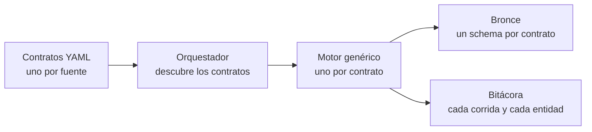

# Menos pipelines, más gobierno

**Guía del patrón de ingesta guiado por metadata en Microsoft Fabric**

Leda Araya · Primus Data · Data Day Colombia 2026

> Esta guía acompaña la charla *«Menos pipelines, más gobierno: el patrón dinámico con metadata DAMA en Fabric»*.
> Explica **el patrón y las decisiones de diseño**, no una implementación lista para copiar: no incluye
> código, definiciones de pipelines ni la estructura completa de los archivos.
> Para profundizar, cada sección enlaza al artículo de la serie de Javier Loria donde se desarrolla la idea.
>
> **¿Quieres implementarlo en tu organización?** En [Primus Data](https://www.primusdata.net/contacto) lo hacemos.

---

## Contenido

1. [El problema](#1-el-problema)
2. [¿Necesitas este patrón?](#2-necesitas-este-patrón)
3. [La idea en una línea](#3-la-idea-en-una-línea)
4. [La convención de nombre](#4-la-convención-de-nombre)
5. [El contrato: un YAML por fuente](#5-el-contrato-un-yaml-por-fuente)
6. [Los componentes del motor](#6-los-componentes-del-motor)
7. [La bitácora](#7-la-bitácora)
8. [La pregunta que ninguna herramienta responde](#8-la-pregunta-que-ninguna-herramienta-responde)
9. [Lo que esto tiene de DAMA](#9-lo-que-esto-tiene-de-dama)
10. [Datos para practicar](#10-datos-para-practicar)
11. [Para llevártelo hoy](#11-para-llevártelo-hoy)
12. [Referencias y créditos](#12-referencias-y-créditos)

---

## 1. El problema

La forma más rápida de empezar a llevar datos a un lakehouse es un pipeline por tabla. Funciona con tres tablas.
Con cincuenta, cada cambio se repite cincuenta veces, y cada pipeline registra lo que hizo a su manera, o no lo registra.

El resultado es doble: **mucho trabajo repetido** y **metadata invisible**. Nadie puede responder con certeza
qué se cargó, cuándo, cuántas filas, desde qué configuración, ni quién es el dueño de cada tabla.

## 2. ¿Necesitas este patrón?

No siempre. Fabric tiene varias formas de copiar datos, y la más simple que resuelva tu caso es la correcta.

| Opción | Pregunta que responde | Ideal para | Ojo |
|---|---|---|---|
| **Copy job** | ¿Cómo muevo datos rápido? | Pocas fuentes; copia completa o incremental sin construir un pipeline | Nombres, dueños y bitácora los defines job por job |
| **Pipeline con Copy activity** | ¿Cómo orquesto el movimiento? | Dependencias, parámetros y lógica a la medida | Un pipeline por tabla no escala ni se gobierna |
| **Pipeline dinámico** | ¿Cómo gobierno y escalo el movimiento? | Muchas tablas y fuentes, con auditoría exigida | Un motor se construye una vez; después mantienes uno, no N |

**Regla honesta:** con 3 a 5 tablas de una sola fuente, un Copy job basta. Si la fuente admite Mirroring o un
Shortcut, eso puede ser incluso mejor. Y hay más opciones, como Dataflows Gen2 o notebooks.

Las opciones no son excluyentes: un motor dinámico usa una Copy activity por dentro. Lo que agrega es gobierno.

## 3. La idea en una línea

> **N fuentes = 1 motor + N archivos de configuración.**
> La configuración dice *qué* se ingiere; el motor decide *cómo*.

Agregar una fuente es agregar un archivo. El pipeline no se toca.
La idea completa está en [*Bronze debería ser aburrido*](https://www.primusdata.net/2026/04/21/bronze-deberia-ser-aburrido/).

## 4. La convención de nombre

Antes de construir nada, decide cómo se llaman los archivos de configuración. Se recomienda que el nombre diga
**el dominio y la fuente**, por ejemplo `farmacia_despachoMedicamentos.yaml`, y que de ese nombre salga el schema
destino en bronce, sin configurarlo a mano.

Así nadie tiene que acordarse del estándar: el motor lo aplica solo. Es una política de gobierno que la plataforma
cumple sin pedir permiso, y obliga a decidir de quién es el dato desde el primer día.

Variantes y criterios para elegir el orden: [*Metadatos hasta el fondo*](https://www.primusdata.net/2026/04/25/metadatos-hasta-el-fondo/).

## 5. El contrato: un YAML por fuente

El archivo de configuración es el **contrato** entre quien entrega los datos y la plataforma. Se recomienda que
incluya tres tipos de información:

| Tipo de metadata | Qué se recomienda incluir | ¿Va en el YAML? |
|---|---|---|
| **Técnica** | De qué sistema vienen los datos, qué entidades traer (por tabla o por consulta) y a dónde van | Sí |
| **De negocio** | Quién es el dueño del dominio, qué tan sensibles son los datos y cómo se clasifican | Sí, como tags |
| **Operacional** | Qué corrió, cuándo, cuántas filas, con qué resultado | **No:** la genera el motor en cada corrida |

Además, conviene que el contrato tenga:
- **Una versión**, para que el formato pueda evolucionar sin romper los archivos que ya existen.
- **Umbrales de volumen por entidad**, para que el motor sepa cuándo una carga llegó incompleta.
- **Una indicación de si se captura el esquema**, para detectar cuándo la fuente cambió.

**Los tags.** Se recomienda usar claves con espacio de nombres, para que no choquen entre sí: `governance.*` para
dueños y responsables, `security.*` para sensibilidad y clasificación. Los tags se definen para todo el dominio y una
entidad puede sobrescribirlos cuando es más sensible que el resto:

| Etiqueta | Ejemplo | Qué significa |
|---|---|---|
| `governance.data_owner` | Dirección de Farmacia | Quién decide quién usa el dato, para qué y con qué calidad |
| `security.sensitivity` | `confidential` (dominio) · `restricted` (entidad) | Qué tan restringido es el acceso |
| `security.classification` | `PII` · `PHI` | *PII*: identifica a una persona. *PHI*: información de salud ligada a una persona |

La convención de tags, la herencia y cómo validar el contrato antes de desplegarlo se explican en
[*Metadatos hasta el fondo*](https://www.primusdata.net/2026/04/25/metadatos-hasta-el-fondo/).

**Por qué YAML en Git y no una tabla de control en SQL.** Las dos opciones funcionan, y la tabla de control es muy usada.
Un archivo versionado en Git trae de serie la revisión del cambio, el historial y la posibilidad de revertir, y lo
lee igual una persona, una máquina o una IA. Si eliges una tabla de control, versiona sus cambios.

**Las credenciales nunca van en el contrato.** El archivo nombra la fuente; la autenticación vive en la conexión.

## 6. Los componentes del motor

El motor es un conjunto pequeño de componentes genéricos que no saben nada de ninguna fuente en particular.
Todo lo específico está en el contrato.

| Componente | Responsabilidad |
|---|---|
| **Orquestador** | Descubre los contratos disponibles y llama al motor una vez por cada uno |
| **Lectura del contrato** | Lee el YAML, lo valida y le entrega al motor la lista de entidades. Un pipeline no lee YAML por sí solo; para eso se usa un notebook |
| **Ingesta** | Copia cada entidad a bronce. Para bases relacionales, un ForEach con una Copy activity parametrizada |
| **Controles** | Después de copiar: valida el volumen contra los umbrales del contrato y captura el esquema |
| **Registro** | Deja huella en la bitácora al empezar, por cada entidad y al terminar |

Bronce es una **copia fiel** de la fuente, enriquecida con metadata, sin transformaciones de negocio.
Se recomienda que el motor registre la corrida **antes** de mover la primera fila: así hasta una carga que falla
deja rastro.

## 7. La bitácora

La bitácora es metadata operacional: nadie la escribe a mano, la genera el proceso en cada corrida.
Se recomienda llevar dos niveles:

- **Por corrida:** identificador de la ejecución y del lote, dominio, inicio, fin, estado y filas procesadas.
- **Por entidad:** qué tabla, cómo terminó, cuántas filas llegaron y de qué contrato y versión salió.

Con eso, preguntas como *¿qué corrió hoy?*, *¿llegó todo?*, *¿de qué versión del contrato salió esta tabla?* o
*¿quién es el dueño?* se responden con una consulta, sin abrir un solo pipeline.

Se recomienda también que la clasificación del contrato (dueño, sensibilidad, PII / PHI) no se quede solo en el YAML:
que **acompañe a la tabla** en bronce y quede en la bitácora, para que quien consulte el dato sepa qué tiene entre manos.

Cómo convertir la bitácora en indicadores para operaciones, calidad y gobierno:
[*Actuamos sobre los metadatos*](https://www.primusdata.net/2026/05/25/actuamos-sobre-los-metadatos/).
Qué pasa cuando el motor llega a producción, y cómo cada incidente termina en un cambio del contrato:
[*Cicatrices de producción*](https://www.primusdata.net/2026/05/11/cicatrices-de-produccion/).

## 8. La pregunta que ninguna herramienta responde

En la demo de la charla, una clínica ficticia tiene dos sistemas: **Pacientes**, con el expediente clínico, cuyo dueño
es la Dirección Clínica, y **Farmacia**, con recetas y despachos, cuyo dueño es la Dirección de Farmacia.
Cada uno llega a la plataforma con su propio contrato.

Farmacia quiere saber a quién le entregó cada medicamento. Sus tablas no lo dicen: para llegar al paciente tiene que
cruzar con el expediente clínico, que es de otra dirección y contiene PII y PHI.

Técnicamente, el cruce funciona. Pero ¿puede Farmacia usar esos datos? ¿Para qué? ¿Quién lo autoriza?

Fabric no lo responde: ejecuta lo que se le pide. El YAML tampoco: dice quién es el dueño de cada tabla, no qué
acuerdan los dueños entre sí. Eso lo responde el **gobierno de datos**: dueños que acuerdan el uso compartido, una
política de acceso y alguien que vele por que se cumpla.

## 9. Lo que esto tiene de DAMA

El patrón *metadata-driven* viene de la ingeniería de datos, no del DAMA-DMBOK. Lo que se le suma es el gobierno encima.
Cuatro áreas del DMBOK2 se vuelven visibles:

| Área DAMA-DMBOK2 | Dónde se ve |
|---|---|
| **Metadatos** (cap. 12) | Técnica y de negocio en el contrato; operacional en la bitácora |
| **Integración e interoperabilidad** (cap. 8) | Un patrón, N dominios. Agregar uno es agregar un archivo |
| **Calidad de datos** (cap. 13) | Umbrales de volumen y captura de esquema por entidad |
| **Gobierno de datos** (cap. 3) | Cada tabla llega con su dueño y su clasificación; la convención de nombre es una política que se cumple sola |

## 10. Datos para practicar

No uses datos reales para aprender el patrón. El **Generador de Datos Sintéticos para Fabric** de Javier Loria
(licencia MIT) crea datasets completos desde archivos YAML, con distribuciones realistas y llaves foráneas entre tablas:
[github.com/JavierSQL/GeneradorDatosSinteticos](https://github.com/JavierSQL/GeneradorDatosSinteticos).
Él mismo lo explica en [*Demos que hablan tu idioma*](https://www.primusdata.net/2026/07/14/demos-que-hablan-tu-idioma-datos-sinteticos-para-fabric-y-power-bi/).

La clínica ficticia de la demo tiene cuatro tablas encadenadas (paciente → diagnóstico → receta → despacho)
en sus dos sistemas. Con eso alcanza para probar los dos casos que importan: el primer dominio, y el segundo que llega sin
tocar el motor.

## 11. Para llevártelo hoy

Tres pasos, aunque hoy sean solo dos tablas:

1. **Define una convención de nombre:** `dominio_fuente`.
2. **Escribe un YAML por fuente:** de dónde vienen los datos, qué entidades y a dónde van, con su dueño y su sensibilidad.
3. **Haz que el motor deje su bitácora:** inicio, fin, estado y filas.

¿Proyecto nuevo? Diseña la ingesta a bronce para escalar desde el día uno. La convención y un YAML por fuente cuestan
casi lo mismo con dos tablas que con doscientas; migrar después un pipeline por tabla cuesta mucho más.

> *El dato no vale por existir. Vale por lo que hace cuando alguien decide gobernarlo.*

## 12. Referencias y créditos

**Serie de Javier Loria (Primus Data).** Esta guía se apoya en ella; la convención de tags `governance.*` / `security.*`
viene de aquí. Vale la pena leerla completa y en orden:

1. [*Bronze debería ser aburrido*](https://www.primusdata.net/2026/04/21/bronze-deberia-ser-aburrido/) (21 abr 2026)
2. [*Metadatos hasta el fondo*](https://www.primusdata.net/2026/04/25/metadatos-hasta-el-fondo/) (25 abr 2026)
3. [*Cicatrices de producción*](https://www.primusdata.net/2026/05/11/cicatrices-de-produccion/) (11 may 2026)
4. [*Actuamos sobre los metadatos*](https://www.primusdata.net/2026/05/25/actuamos-sobre-los-metadatos/) (25 may 2026)
5. [*Demos que hablan tu idioma: datos sintéticos para Fabric y Power BI*](https://www.primusdata.net/2026/07/14/demos-que-hablan-tu-idioma-datos-sinteticos-para-fabric-y-power-bi/) (14 jul 2026)

**Generador de datos sintéticos.** Loria, J. (2026). *GeneradorDatosSinteticos*. Licencia MIT.
[github.com/JavierSQL/GeneradorDatosSinteticos](https://github.com/JavierSQL/GeneradorDatosSinteticos)

**DAMA International** (2017). *DAMA-DMBOK: Data Management Body of Knowledge*, 2.ª ed. Technics Publications.
Capítulos 3 (Gobierno), 8 (Integración), 12 (Metadatos) y 13 (Calidad).

**Microsoft Learn** (consultado el 4 de octubre de 2026):
- [Copy job](https://learn.microsoft.com/en-us/fabric/data-factory/what-is-copy-job)
- [Copy activity con Lakehouse](https://learn.microsoft.com/en-us/fabric/data-factory/connector-lakehouse-copy-activity)
- [Copy activity con Warehouse](https://learn.microsoft.com/en-us/fabric/data-factory/connector-data-warehouse-copy-activity)
- [Consultas entre bases de datos](https://learn.microsoft.com/en-us/fabric/data-warehouse/query-warehouse)
- [Git integration para Warehouse](https://learn.microsoft.com/en-us/fabric/data-warehouse/git-integration)
- [Alta concurrencia en pipelines](https://learn.microsoft.com/en-us/fabric/data-engineering/configure-high-concurrency-session-notebooks-in-pipelines)

---

© 2026 Leda Araya · Primus Data. Todos los derechos reservados
